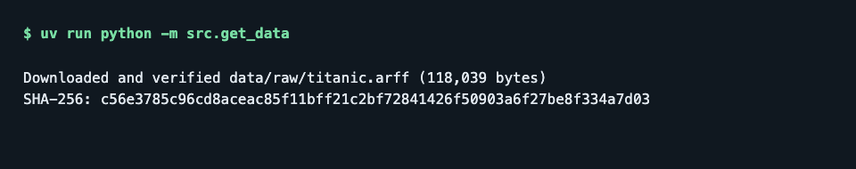

# ДЗ №1. Воспроизводимый ML-проект

Загрузил Titanic №40945 с OpenML без токена и проверил SHA-256 исходного файла.
Настроил зависимости через `uv.lock` и проверки Ruff через pre-commit.
Команды из [README](../README.md) проверил в чистой копии проекта.

## Загрузка данных

## Проверки кода

Ruff проверил стиль и форматирование. В отдельной проверке Ruff отклонил
временный файл с неиспользуемым импортом (ошибка F401).

## Обучение

Логистическая регрессия обучилась на 1 047 строках. На 262 тестовых строках
accuracy составила **80,15%**, ROC-AUC — **0,8718**. После удаления артефактов
повторный запуск создал модель и JSON с теми же значениями метрик.

## Что делает каждая команда

Команды выполняются из корня репозитория, где лежит
[`pyproject.toml`](../pyproject.toml).

### 1. `uv sync --locked`

Создаёт окружение `.venv` и устанавливает в него зависимости проекта,
включая scikit-learn, Ruff и pre-commit. Версии берутся из
[`uv.lock`](../uv.lock). Если файл нужно обновить, например после изменения
зависимостей в `pyproject.toml`, флаг `--locked` приводит к ошибке. Так можно
проверить, что проект действительно устанавливается из зафиксированного набора
версий.

### 2. `uv run pre-commit install`

Устанавливает локальный Git-хук `.git/hooks/pre-commit`. При обычном
`git commit` Git запускает этот хук, и pre-commit проверяет Python-файлы,
подготовленные к коммиту. Если проверка падает, коммит останавливается.
Установку хуков повторяют в каждом новом клоне, если хотят включить
автоматическую проверку перед коммитами.

### 3. `uv run pre-commit run --all-files`

Запускает проверки вручную по всем отслеживаемым Python-файлам. В этом проекте
[`ruff check`](../.pre-commit-config.yaml#L3) ловит, например, неиспользуемые
импорты, а [`ruff format --check`](../.pre-commit-config.yaml#L8) проверяет
форматирование. При успехе рядом с обеими проверками появится `Passed`.
Ручная проверка работает и без установки Git-хука.

### 4. `uv run python -m src.get_data`

Запускает [модуль загрузки](../src/get_data.py#L12). Он скачивает Titanic
№40945 с OpenML без токена, проверяет SHA-256 и записывает файл в
`data/raw/titanic.arff`. При успехе команда выводит путь к файлу и его
контрольную сумму.

### 5. `uv run python -m src.train`

Запускает [модуль обучения](../src/train.py#L23). Он читает скачанный ARFF,
делит пассажиров на обучающую и тестовую выборки с фиксированным seed,
обучает логистическую регрессию и оценивает её на тестовой выборке.
В `artifacts/model.pkl` сохраняется модель вместе с предобработкой, а в
`artifacts/metrics.json` — accuracy, ROC-AUC и размеры выборок. Метрики также
появятся в терминале.

## Частые вопросы

**Зачем везде `uv run`?** Он запускает команды в окружении проекта.
Вручную активировать `.venv` не нужно.

**Что значит `python -m`?** Python находит и запускает модуль по имени.
Например, `src.get_data` соответствует файлу `src/get_data.py`.

**Что нужно делать каждый раз?** Окружение настраивают при первом запуске
или после изменения зависимостей, хук устанавливают один раз на клон.
Данные скачивают, если файла ещё нет. Проверки и обучение можно повторять
по мере работы. Повторное обучение перезапишет модель и метрики.

**Что означают метрики?** Accuracy показывает долю верных прогнозов.
ROC-AUC показывает, насколько хорошо модель ставит выживших выше
невыживших по предсказанной вероятности при сравнении пар пассажиров.

**Почему в GitHub нет датасета и модели?** Их создают команды загрузки
и обучения. Папки `data/raw/` и `artifacts/` указаны в
[`.gitignore`](../.gitignore).
