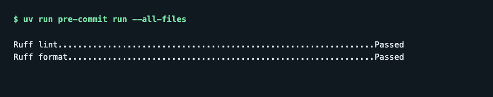
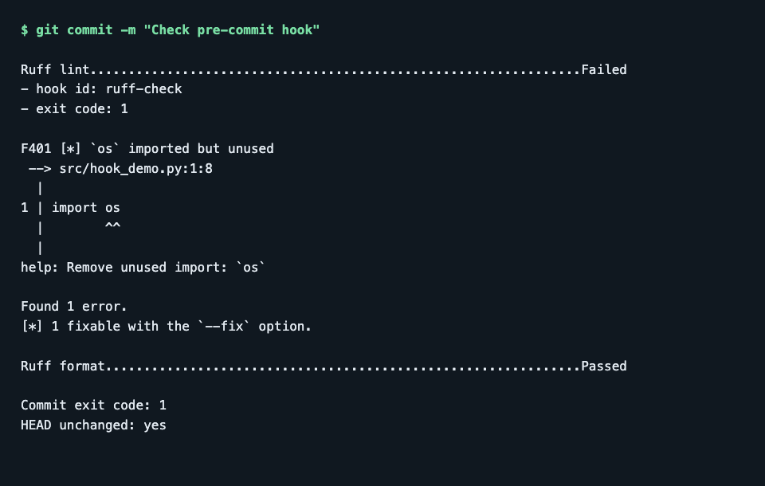
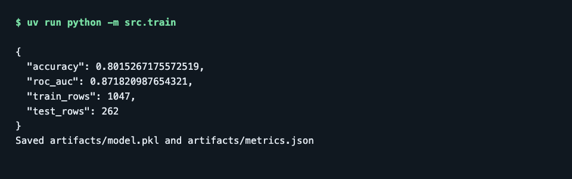

# ДЗ №1. Воспроизводимый ML-проект

## Как проходит запуск

1. `uv sync --locked` устанавливает зависимости в `.venv`.
   [Настройки проекта](../pyproject.toml#L1) · [Зафиксированные версии](../uv.lock)
2. `uv run pre-commit run --all-files` проверяет Python-код через Ruff.
   `uv run pre-commit install` подключает те же проверки к будущим коммитам.
   [Конфигурация проверок](../.pre-commit-config.yaml#L1)
3. `uv run python -m src.get_data` скачивает Titanic без токена, проверяет SHA-256
   и сохраняет файл в `data/raw/titanic.arff`.
   [Датасет OpenML](https://www.openml.org/d/40945) · [Код загрузки](../src/get_data.py#L12)
4. `uv run python -m src.train` читает этот файл, обучает логистическую регрессию
   на 80% данных и оценивает её на оставшихся 20%. Команда создаёт
   `artifacts/model.pkl` и `artifacts/metrics.json` локально.
   [Код обучения](../src/train.py#L23) · [Метрики проверенного запуска](hw-1/metrics.json)

Воспроизводимость проверена в свежем клоне репозитория с GitHub.
По README установил зависимости из `uv.lock`, прогнал pre-commit, скачал
Titanic с нуля и обучил модель. После удаления артефактов повторный запуск
создал модель и JSON с теми же метриками. [Инструкция запуска](../README.md#запуск)

## Загрузка данных

## Проверки кода

Ruff проверил стиль и форматирование.

Во временном клоне я добавил файл с неиспользуемым `import os` и запустил
`git commit`. Ruff выдал ошибку `F401`, команда завершилась с кодом 1,
а `HEAD` остался на прежнем коммите.

## Обучение

Логистическая регрессия обучилась на 1 047 строках. На 262 тестовых строках
accuracy составила **80,15%**, ROC-AUC — **0,8718**.

[Метрики проверенного запуска в JSON](hw-1/metrics.json).

[Подробный разбор команд и частые вопросы](hw-1-guide.md)
