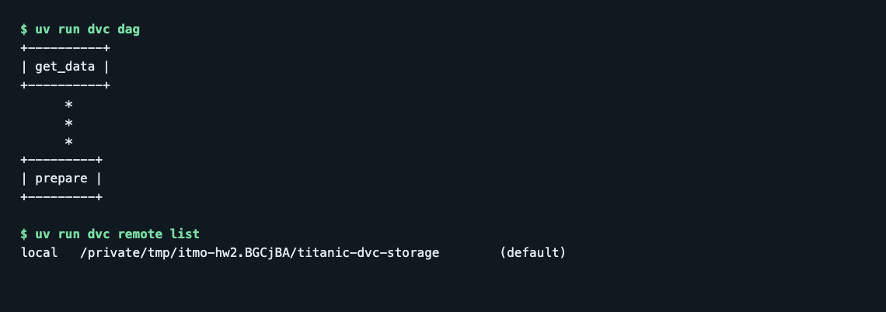
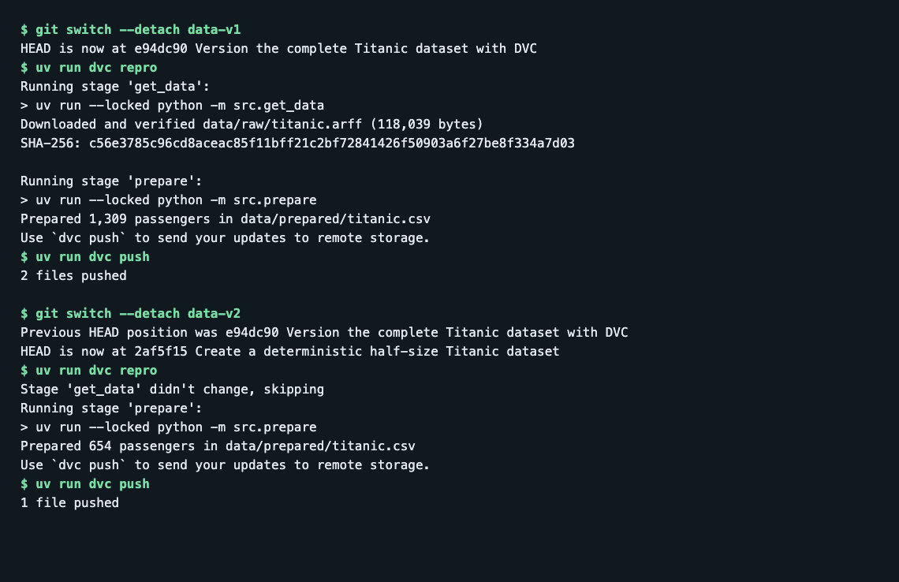
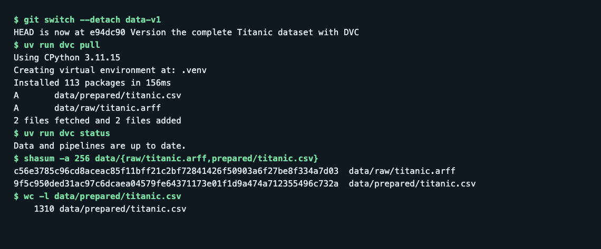
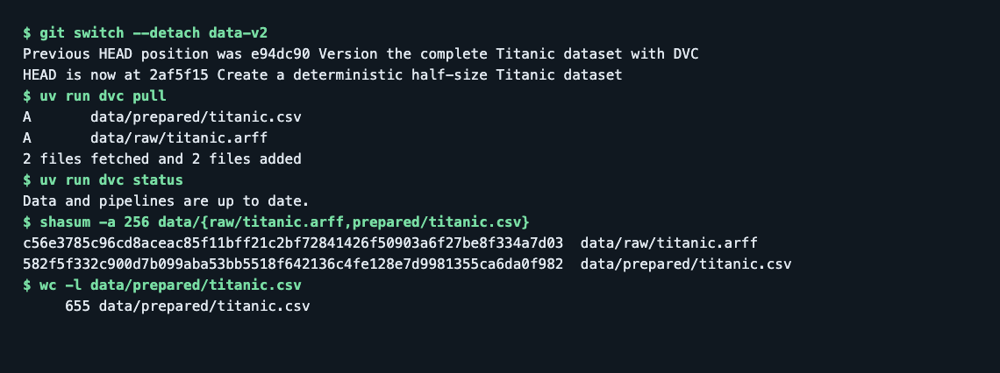

# ДЗ №2. Версионирование данных Titanic

`get_data` скачивает OpenML Titanic и проверяет SHA-256. `prepare`
читает исходный ARFF и сохраняет признаки и целевую переменную в CSV.
Оба файла отслеживает DVC. [Пайплайн](../dvc.yaml#L1) · [Схема данных](../data/README.md)

## Пайплайн и хранилище

Remote `local` — каталог `titanic-dvc-storage` рядом с репозиторием.
В свежем клоне запустил `dvc repro` и загрузил обе версии в это хранилище
через `dvc push`. На другой машине хранилище можно заполнить теми же
командами из публичного источника. [Настройки remote](../.dvc/config#L1) · [Инструкция](../README.md#дз-2-версии-данных-в-dvc)

## Восстановление версий

В отдельном свежем клоне переключился по тегам. Перед каждым `dvc pull`
в клоне отсутствовали исходный ARFF, подготовленный CSV и локальный кэш DVC.
Оба файла восстановились из хранилища, и `dvc status` подтвердил,
что данные и пайплайн актуальны.

| Версия | Пассажиров | Состав |
|---|---:|---|
| [`data-v1`](https://github.com/naumtsevalex/itmo_2026_AITH-ML-Eng-Practices/tree/data-v1) | 1 309 | Полный набор |
| [`data-v2`](https://github.com/naumtsevalex/itmo_2026_AITH-ML-Eng-Practices/tree/data-v2) | 654 | Подвыборка с seed 42 и стратификацией по `survived` |

`wc -l` также считает заголовок CSV. SHA-256 исходного ARFF совпал,
а SHA-256 подготовленного CSV различается. Схема обеих версий одинакова,
все строки второй версии входят в первую. [Метаданные DVC](../dvc.lock#L1)

