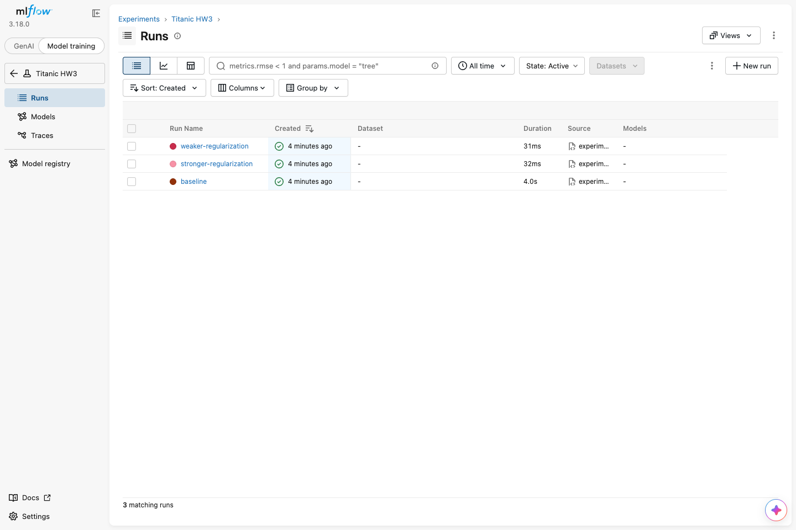
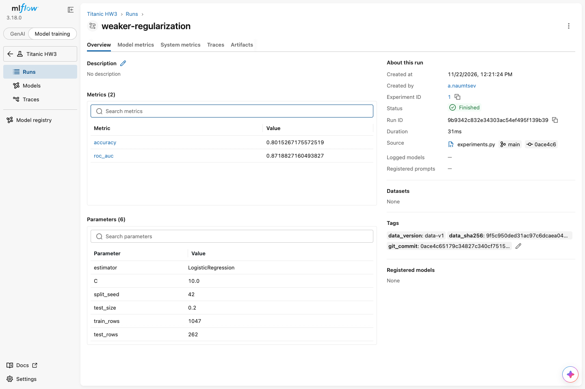
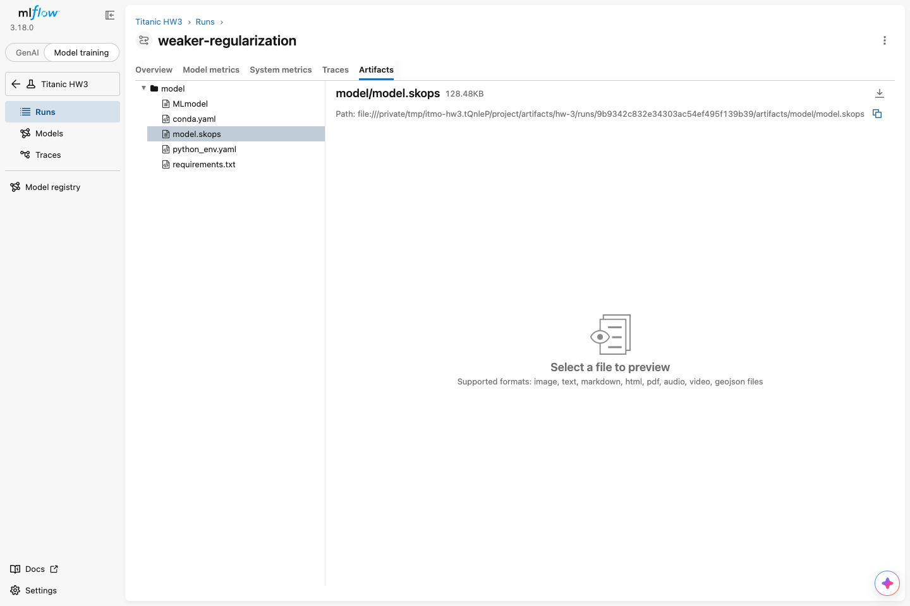
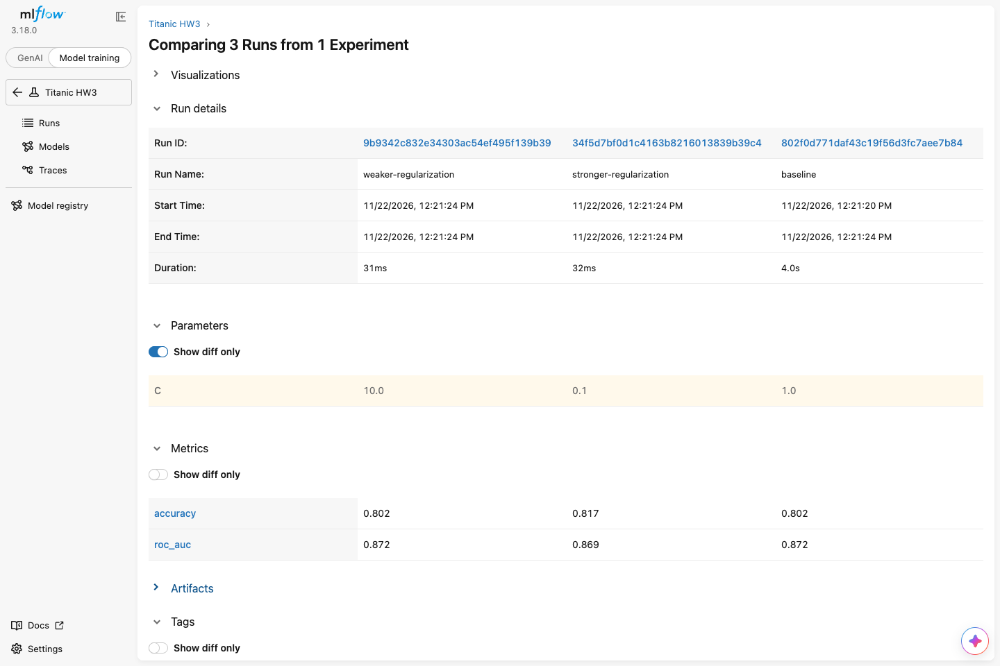

# ДЗ №3. Трекинг экспериментов Titanic в MLflow

## Данные и запуск

Через DVC восстановил подготовленный CSV версии `data-v1` со всеми
1 309 пассажирами. Скрипт сверяет SHA-256 файла и один раз делает
стратифицированное разбиение 80/20 с seed 42. Все три модели обучаются
на одних и тех же 1 047 строках и проверяются на одних и тех же 262.
Предобработка входит в модель и обучается на train. [Версия данных](https://github.com/naumtsevalex/itmo_2026_AITH-ML-Eng-Practices/tree/data-v1) · [Команды запуска](../README.md#дз-3-эксперименты-в-mlflow)

Один запуск `uv run python -m src.experiments` создаёт три записи в
локальном эксперименте **Titanic HW3**. Для каждой записи логируются
параметры, accuracy, ROC-AUC, модель и теги `data_version`,
`data_sha256` и `git_commit`. Проверил в свежем клоне, что все три
сохранённые модели загружаются из MLflow и дают записанные метрики.
[Скрипт](../src/experiments.py#L29) · [0ace4c6](https://github.com/naumtsevalex/itmo_2026_AITH-ML-Eng-Practices/commit/0ace4c65179c34827c340cf751514e7e4f8db1d7)

## Сравнение

Во всех запусках используется логистическая регрессия с одинаковыми
признаками и предобработкой. Меняется только `C`. Чем меньше его значение, тем сильнее регуляризация.

| Запуск | `C` | Accuracy | ROC-AUC |
|---|---:|---:|---:|
| Baseline | 1,0 | 0,801527 | 0,871821 |
| Сильнее регуляризация | 0,1 | **0,816794** | 0,869414 |
| Слабее регуляризация | 10,0 | 0,801527 | **0,871883** |

## Вывод

По основной метрике ROC-AUC в этом сравнении выбираю **`C=10`**.
ROC-AUC оценивает ранжирование пассажиров по вероятности выживания при разных
порогах. Выигрыш над baseline составляет лишь **0,000062**, а accuracy
совпадает. При текущем пороге наибольшую accuracy дал `C=0.1`. Сравнение
сделано на одном разбиении из 262 тестовых строк, поэтому преимущество
`C=10` стоит проверить на других разбиениях перед окончательным выбором.
