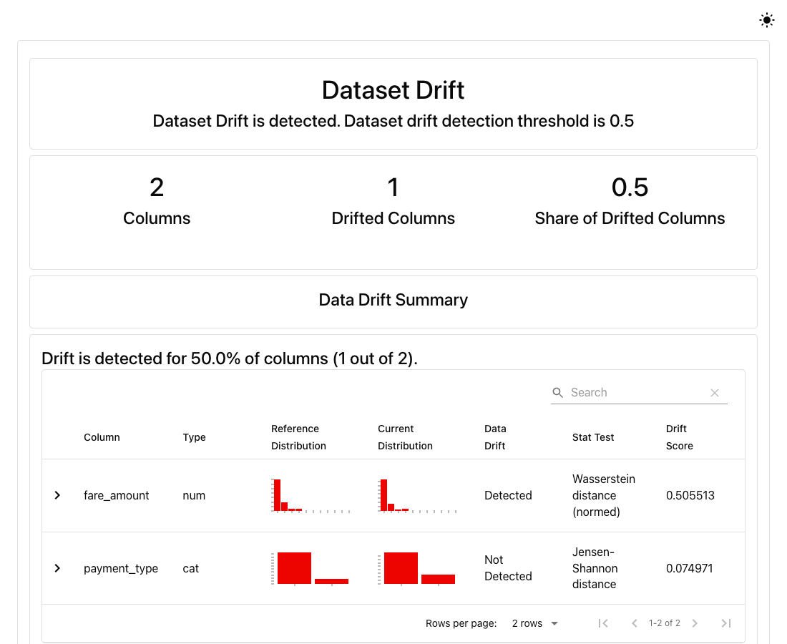
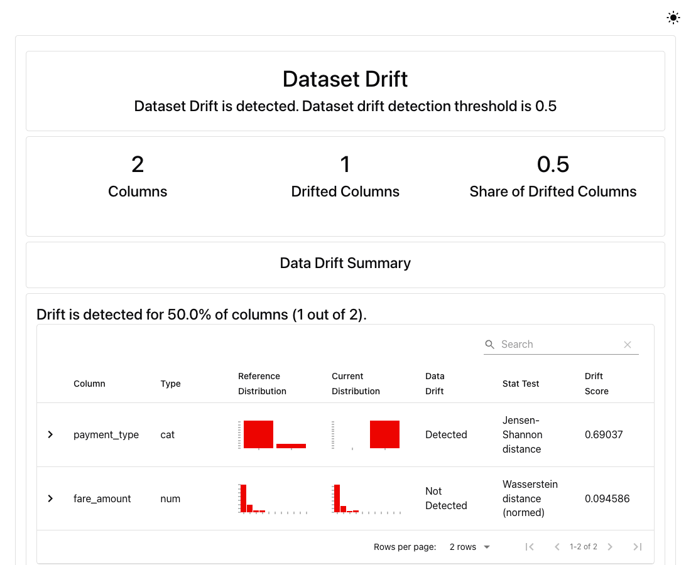

# Evidently за 10 минут

Evidently — Python-библиотека для оценки данных и предсказаний моделей. Представь, что сервис прогноза выручки такси получил данные о поездках за сегодня. Сначала хочется узнать, заполнены ли признаки, затем — похожи ли новые данные на привычные. Когда появятся фактические исходы, можно проверить и качество прогнозов. Для каждого из этих вопросов у Evidently есть готовый набор метрик. [Обзор библиотеки](https://docs.evidentlyai.com/docs/library/overview)

## 1. Как устроена одна проверка

| Понятие | Пример из данных такси |
|---|---|
| **Current и reference** | Current — партия, которую проверяем. Reference — база сравнения, например поездки за прошлый период. Чтобы посчитать долю пропусков сегодня, хватит current. Для сравнения распределений нужны обе таблицы. [Работа с данными](https://docs.evidentlyai.com/docs/library/data_definition) |
| **Dataset и DataDefinition** | Dataset содержит таблицу, DataDefinition задаёт смысл колонок. Для оценки модели указываем, где фактическая выручка и где прогноз. Для простого примера с числовыми признаками достаточно передать DataFrame. [Описание колонок](https://docs.evidentlyai.com/docs/library/data_definition) |
| **Metric и Preset** | Metric отвечает на один вопрос, например изменилось ли распределение `fare`. Preset собирает несколько связанных проверок. Для первого запуска удобен готовый `DataDriftPreset()`. [Каталог пресетов](https://docs.evidentlyai.com/metrics/all_presets) |
| **Report и результат запуска** | `Report([...])` описывает, что посчитать. `.run(...)` выполняет расчёт. Результат можно открыть как интерактивный HTML или получить в Python через `.dict()`. [Отчёты](https://docs.evidentlyai.com/docs/library/report) · [Форматы вывода](https://docs.evidentlyai.com/docs/library/output_formats) |
| **Test** | Условие для автоматического решения. Например, задание может требовать, чтобы доля пустых значений укладывалась в установленный предел. `include_tests=True` включает стандартные условия для поддерживаемых метрик. [Тесты и пороги](https://docs.evidentlyai.com/docs/library/tests) |

## 2. Три инструмента, с которых стоит начать

| Что хочешь узнать | Что взять | На что смотреть |
|---|---|---|
| Что пришло в таблице? | `DataSummaryPreset()` | Число строк, пропуски, уникальные значения и распределения. Например, у какой доли поездок пропущена стоимость. [Data Summary](https://docs.evidentlyai.com/metrics/preset_data_summary) |
| Изменился ли вход модели? | `DataDriftPreset()` | Доля признаков со сдвигом и результат по каждому признаку. Это основной инструмент нашего доклада. [Data Drift](https://docs.evidentlyai.com/metrics/preset_data_drift) |
| Насколько точны прогнозы? | `ClassificationPreset()` | Нужны фактический класс и прогноз. Для классификатора можно посмотреть accuracy, precision, recall и матрицу ошибок. Для числовой цели есть `RegressionPreset()`. [Классификация](https://docs.evidentlyai.com/metrics/preset_classification) · [Регрессия](https://docs.evidentlyai.com/metrics/preset_regression) |

## 3. Как выглядит drift на настоящем отчёте

Официальный файл NYC TLC за ноябрь 2023 года содержит **3 339 715 поездок** жёлтых такси. Берём два четверга по местному времени начала поездки. В обеих партиях одинаковые правила отбора: базовая стоимость от 0 (исключая) до 200 долларов включительно, оплата картой или наличными. Используем все подходящие строки. [Файл NYC TLC, Parquet](https://d37ci6vzurychx.cloudfront.net/trip-data/yellow_tripdata_2023-11.parquet) · [Код отбора](drift.py#L13)

| Партия | Поездки | Медиана базовой стоимости | Доля наличных |
|---|---:|---:|---:|
| Reference, 16 ноября | 123 526 | $14,20 | 14,41% |
| Current, 23 ноября (День благодарения) | 57 951 | $12,80 | 22,61% |

**Как читать две разные колонки.** Для числовой `fare_amount` Evidently сравнивает распределения стоимости нормированным расстоянием Вассерштейна. Для категориальной `payment_type` он сравнивает доли категорий расстоянием Дженсена — Шеннона. Код преобразует коды 1 и 2 в названия `card` и `cash`. Для обоих методов задали порог 0,1. У каждой метрики своя шкала. [Методы и пороги](https://docs.evidentlyai.com/metrics/customize_data_drift)

| Сценарий | Стоимость | Способ оплаты | Где сработал детектор |
|---|---:|---:|---|
| Две реальные даты | 0,095 | 0,075 | Оба значения ниже порога |
| К каждой поездке 23 ноября прибавили $10 | **0,506** | 0,075 | Стоимость |
| В исходной партии 23 ноября все оплаты записали как наличные | 0,095 | **0,690** | Способ оплаты |

**Две реальные даты.** Доля наличных выросла примерно на 8,2 процентного пункта, но при выбранном пороге сигнал по оплате не сработал. Одной пары дней недостаточно, чтобы приписать разницу празднику.


**Числовой признак.** Имитация ошибки тарификации сместила распределение стоимости вправо. Смотри строку `fare_amount`, сравни гистограммы и значение Drift Score с порогом.



**Категориальный признак.** Отдельно моделируем сбой в кодировании платежей: все поездки получили категорию `cash`. В отчёте изменилась доля категорий. После такого сигнала стоит проверить маппинг кодов и свериться с платёжной системой. Для вывода о качестве модели потребуются прогнозы и фактические результаты.



## 4. Как повторить локально

Из корня репозитория выполни:

```bash
uv sync --locked
mkdir -p artifacts/evidently
curl -fL --retry 2 https://d37ci6vzurychx.cloudfront.net/trip-data/yellow_tripdata_2023-11.parquet -o artifacts/evidently/yellow_tripdata_2023-11.parquet
uv run --locked --with 'evidently==0.7.23' python -m seminar.evidently.quickstart.drift
```

Файл весит около 54 МиБ. Для повторной демонстрации достаточно последней команды. Открой в браузере `control.html`, `shifted.html` и `payment.html` в папке `artifacts/evidently/`. [Официальный пример Evidently](https://docs.evidentlyai.com/quickstart_ml)

## 5. Что ещё умеет Evidently

Если запускать проверки регулярно, результаты можно сохранять в проекте и смотреть динамику метрик на дашборде. Для текстов и LLM есть дескрипторы — они вычисляют оценку для каждой строки, например длину ответа, которую затем можно анализировать по всей выборке. Для нашего двадцатиминутного доклада достаточно уметь прочитать один отчёт до и после сдвига. [Дашборды](https://docs.evidentlyai.com/docs/platform/dashboard_overview) · [Дескрипторы](https://docs.evidentlyai.com/docs/library/descriptors)
