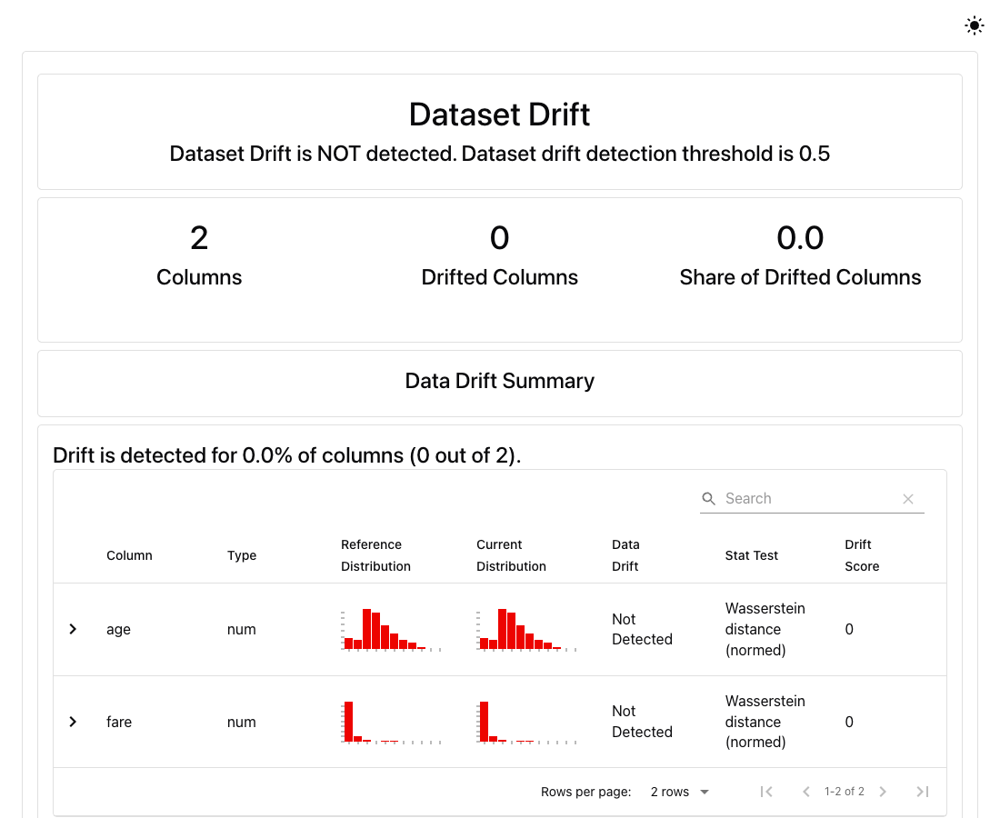

# Evidently за 10 минут

Evidently — Python-библиотека для оценки данных и предсказаний моделей. Представь, что в сервис с моделью Titanic пришла новая партия пассажиров. Сначала хочется узнать, заполнены ли признаки, затем — похожи ли новые данные на привычные. Когда появятся фактические исходы, можно проверить и качество прогнозов. Для каждого из этих вопросов у Evidently есть готовый набор метрик. [Обзор библиотеки](https://docs.evidentlyai.com/docs/library/overview)

## 1. Как устроена одна проверка

| Понятие | Что это значит на Titanic |
|---|---|
| **Current и reference** | Current — партия, которую проверяем. Reference — база сравнения, например пассажиры за прошлый период. Чтобы посчитать долю пропусков сегодня, хватит current. Для сравнения распределений нужны обе таблицы. [Работа с данными](https://docs.evidentlyai.com/docs/library/data_definition) |
| **Dataset и DataDefinition** | Dataset содержит таблицу, DataDefinition задаёт смысл колонок. Для оценки модели указываем, где фактический исход и где прогноз. Для простого примера с числовыми признаками достаточно передать DataFrame. [Описание колонок](https://docs.evidentlyai.com/docs/library/data_definition) |
| **Metric и Preset** | Metric отвечает на один вопрос, например изменилось ли распределение `fare`. Preset собирает несколько связанных проверок. Для первого запуска удобен готовый `DataDriftPreset()`. [Каталог пресетов](https://docs.evidentlyai.com/metrics/all_presets) |
| **Report и результат запуска** | `Report([...])` описывает, что посчитать. `.run(...)` выполняет расчёт. Результат можно открыть как интерактивный HTML или получить в Python через `.dict()`. [Отчёты](https://docs.evidentlyai.com/docs/library/report) · [Форматы вывода](https://docs.evidentlyai.com/docs/library/output_formats) |
| **Test** | Условие для автоматического решения. Например, задание может требовать, чтобы доля пустых значений укладывалась в установленный предел. `include_tests=True` включает стандартные условия для поддерживаемых метрик. [Тесты и пороги](https://docs.evidentlyai.com/docs/library/tests) |

## 2. Три инструмента, с которых стоит начать

| Что хочешь узнать | Что взять | На что смотреть |
|---|---|---|
| Что пришло в таблице? | `DataSummaryPreset()` | Число строк, пропуски, уникальные значения и распределения. Например, какая доля пассажиров пришла без возраста. [Data Summary](https://docs.evidentlyai.com/metrics/preset_data_summary) |
| Изменился ли вход модели? | `DataDriftPreset()` | Доля признаков со сдвигом и результат по каждому признаку. Это основной инструмент нашего доклада. [Data Drift](https://docs.evidentlyai.com/metrics/preset_data_drift) |
| Насколько точны прогнозы? | `ClassificationPreset()` | Нужны фактический класс и прогноз. Для Titanic можно посмотреть accuracy, precision, recall и матрицу ошибок. Для числовой цели есть `RegressionPreset()`. [Классификация](https://docs.evidentlyai.com/metrics/preset_classification) · [Регрессия](https://docs.evidentlyai.com/metrics/preset_regression) |

## 3. Как выглядит drift на настоящем отчёте

В мониторинге reference и current часто задаются временем: например, стабильный период и сегодняшняя партия. Для учебного примера на Titanic моделируем изменение сами. Берём всех 1 309 пассажиров и сравниваем две колонки, `fare` и `age`. Reference — исходные данные, current — их копия. После контрольного прогона увеличиваем каждый известный тариф в current на 30. Пассажиры, возраст и пропуски в обеих таблицах совпадают. [Рабочий пример](drift.py#L11)

**До изменения.** В верхней карточке видно **0 из 2** признаков со сдвигом. В таблице ниже можно сверить гистограммы reference и current по каждой колонке.



**После изменения.** В сводке теперь **1 из 2**. Чтобы понять причину, найди строку `fare`, сравни гистограммы и прочитай поля **Stat Test** и **Drift Score**. В интерактивном HTML стрелка слева раскрывает детали.


**Почему появился сигнал?** Для сравнения копий используем нормированное расстояние Вассерштейна. Оно показывает величину различия между распределениями. При сравнении одинаковых значений расстояние равно 0. После прибавления 30 к тарифу расстояние для `fare` составило **0,580** при заданном пороге **0,1**. Для `age` оно осталось равным 0. Число **0,5** в заголовке — порог доли признаков со сдвигом для сигнала по датасету. Сработал один из двух. [Как работает детектор](https://docs.evidentlyai.com/metrics/explainer_drift) · [Методы и пороги](https://docs.evidentlyai.com/metrics/customize_data_drift)

**Как объяснить результат на семинаре?** Распределение тарифов изменилось. В реальном сервисе я бы проверил единицы тарифа и долю пассажиров каждого класса. Чтобы выяснить, повлиял ли сдвиг на качество модели, нужны прогнозы и соответствующие фактические исходы.

## 4. Как повторить локально

Из корня репозитория выполни:

```bash
uv sync --locked
uv run --locked python -m src.get_data
uv run --locked --with 'evidently==0.7.23' python -m seminar.evidently.quickstart.drift
```

Первая команда устанавливает окружение проекта. Вторая скачивает полный Titanic с OpenML. Третья запускает пример с Evidently 0.7.23. При первом запуске нужен интернет для загрузки данных и пакетов. Открой в браузере `artifacts/evidently/control.html`, затем `artifacts/evidently/shifted.html`. В терминале выводятся значения с полной точностью. [Официальный пример для табличных данных](https://docs.evidentlyai.com/quickstart_ml)

## 5. Что ещё умеет Evidently

Если запускать проверки регулярно, результаты можно сохранять в проекте и смотреть динамику метрик на дашборде. Для текстов и LLM есть дескрипторы — они вычисляют оценку для каждой строки, например длину ответа, которую затем можно анализировать по всей выборке. Для нашего двадцатиминутного доклада достаточно уметь прочитать один отчёт до и после сдвига. [Дашборды](https://docs.evidentlyai.com/docs/platform/dashboard_overview) · [Дескрипторы](https://docs.evidentlyai.com/docs/library/descriptors)
