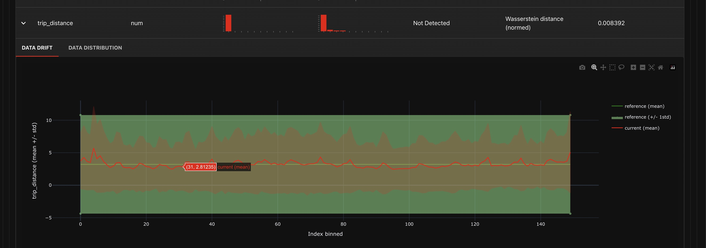

# Почему Evidently показывает графики и как принимает решение о drift

В нашем примере сравниваем поездки NYC Taxi за 8 ноября 2023 года (reference) и 15 ноября (current). Начни со строки `trip_distance` на скриншоте. В ней уже есть ответ детектора: **Wasserstein distance (normed) = 0,008392**, статус **Not Detected**.

## Зачем три представления одного признака

| Что открыть | На какой вопрос отвечает |
|---|---|
| **Data Drift**, красная линия и цветные полосы | Как ведут себя среднее и разброс в последовательных группах строк current? Подсказка «31, 2.81235» означает, что в бине № 31 поездка в среднем длилась 2,81 мили. Зелёная линия задаёт среднее всего reference. [Как читать оси и полосы](trip-distance.md) |
| **Data Distribution**, гистограммы или столбцы категорий | Где именно различаются две партии? Например, стало ли больше дорогих поездок или увеличилась доля наличных. Здесь удобно искать объяснение сигнала. |
| **Stat Test, Drift Score, Data Drift** в строке признака | Какой метод применён, какое число он вернул и достигло ли оно порога? Для обоих методов нашего демо при расстоянии **≥ 0,1** появляется **Detected**. [Настройка детекторов](drift.py#L51) |

Графики и расчёт используют одни и те же поездки. Красная линия сжимает их до средних по бинам. Если перемешать строки и заново пронумеровать их, линия может измениться. Оба детектора дадут прежние числа, поскольку значения и частоты в каждой партии сохранились. Пересечение красной линией края зелёной полосы само по себе не запускает сигнал.

## 1. Вассерштейн — насколько сместились числовые значения?

Представь две группы тарифов в долларах: **[10, 20, 30]** и **[20, 30, 40]**. После сортировки каждая пара отличается на $10. Для двух выборок одинакового размера обычное расстояние Вассерштейна равно среднему абсолютному различию таких пар — здесь **$10**. У реальных партий размеры могут различаться, тогда метод сопоставляет доли распределений.

Evidently делит полученное расстояние на стандартное отклонение reference (с нижней границей знаменателя 0,001). Так получается безразмерный **Drift Score**. Для длины поездки **0,008392** означает расстояние около **0,84% от эталонного стандартного отклонения**. Порог 0,1 соответствует десятой части такого отклонения. Для тарифа на исходных датах получили **0,0095**, а после искусственной надбавки $10 — **0,6075**. Сработал детектор тарифа. [Методы Evidently](https://docs.evidentlyai.com/metrics/customize_data_drift) · [Определение расстояния в SciPy](https://docs.scipy.org/doc/scipy/reference/generated/scipy.stats.wasserstein_distance.html)

## 2. Дженсен — Шеннон — насколько изменились доли категорий?

Для способа оплаты сначала составляем две таблицы долей в одном порядке: карта, наличные. За 8 ноября это примерно **[85,90%, 14,10%]**, за 15 ноября — **[85,91%, 14,09%]**. Метод сравнивает каждый профиль с их общим средним профилем и сводит расхождения в одно расстояние. Одинаковые профили дают 0.

На исходных поездках расстояние равно **0,000046**. Когда в копии данных за 15 ноября все оплаты заменили на наличные, второй профиль стал **[0%, 100%]**, а расстояние выросло до **0,6927**. Порог 0,1 пройден. Тот же принцип используется для долей поездок из каждой зоны посадки и с разным числом пассажиров. [Дженсен — Шеннон в SciPy](https://docs.scipy.org/doc/scipy/reference/generated/scipy.spatial.distance.jensenshannon.html)

## 3. Как перейти от одного признака к выводу по датасету?

В каждом искусственном сценарии сработал **1 из 5 признаков**, то есть **20%**. Порог верхней карточки Dataset Drift равен **50%**. Поэтому у конкретной колонки видим **Detected**, а по датасету в целом — **Not Detected**. Для объяснения инцидента стоит назвать колонку, метод, значение и порог. [Результаты для всех пяти признаков](README.md#3-как-выглядит-drift-на-настоящем-отчёте)

Хотя в интерфейсе колонка называется **Stat Test**, в этом демо оба числа — **расстояния**. Чем больше число, тем сильнее различаются распределения по выбранной мере. Значение 0,6075 не означает вероятность drift 60,75%. Например, у доступного в Evidently теста Колмогорова — Смирнова результатом служит p-value и сигнал возникает при малом значении. Всегда читай Drift Score вместе с названием метода. [Справочник методов и порогов](https://docs.evidentlyai.com/metrics/customize_data_drift)
