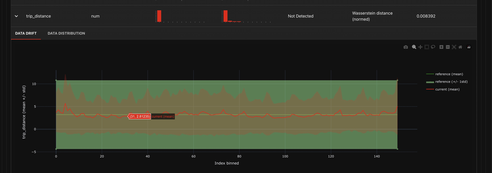

# Как читать график длины поездок NYC Taxi в Evidently

Сравниваем длину поездок жёлтого такси Нью-Йорка за две среды. Эталонная выборка (`reference`) — 117 271 поездка за 8 ноября 2023 года. Текущая (`current`) — 117 344 поездки за 15 ноября. На скриншоте открыта вкладка **Data Drift** для признака **trip_distance**.

### 1. Что означает точка (31, 2.81235)?

По горизонтали — **номер группы поездок**, по вертикали — **расстояние в милях**. Для графика Evidently разбил индексы строк текущей выборки на 150 интервалов, примерно по 782 поездки в каждом. Такое деление называется *биннингом*. Число 31 обозначает один из этих интервалов. Средняя длина поездки в нём — **2,81 мили**. По номеру бина нельзя определить час поездки.

### 2. Почему зелёная линия прямая, а красная меняется?

Зелёная линия — один ориентир для всего графика: средняя длина поездки за **весь эталонный день**, около **3,2 мили**. У красной линии каждая точка — среднее **своего бина** за 15 ноября. В бине 31 среднее примерно на 0,4 мили ниже эталонного. Это наблюдение об одной группе поездок.

### 3. Что показывает бледно-красная полоса?

Для каждого бина Evidently берёт среднее и откладывает вверх и вниз по одному стандартному отклонению (σ). Оно измеряется в милях. Широкая полоса означает, что длины отдельных поездок сильно различаются даже при похожем среднем. У зелёной полосы тот же принцип, только разброс посчитан за весь эталонный день.

На рисунке около начала красной линии виден верхний пик. Чтобы понять его форму, представь два соседних бина. При среднем 5 и σ = 2 границы будут **3 и 7**. Если в следующем бине среднее выросло до 6 и σ выросло до 3, границы станут **3 и 9**. Верх поднялся, низ остался на месте, а полоса в каждом бине симметрична относительно своей красной точки. По той же причине зелёная заливка на скриншоте уходит ниже нуля: таков результат вычитания σ из среднего. Фактический минимум поездки по этой границе определить нельзя.

### 4. Какой вывод сделать по этому скриншоту?

Смотри строку **trip_distance** над графиком. Нормированное расстояние Вассерштейна между распределениями за два дня равно **0,008392**. Для числовых признаков в нашем демо установлен порог **0,1**, поэтому Evidently показал **Not Detected**. Бины помогают увидеть колебания среднего. Для итоговой проверки Evidently сравнивает полные распределения длин поездок за обе даты. [Методы и пороги Evidently](https://docs.evidentlyai.com/metrics/customize_data_drift)
